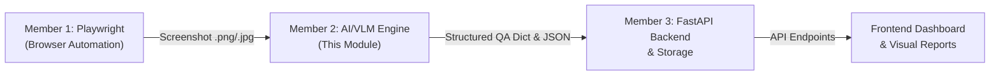
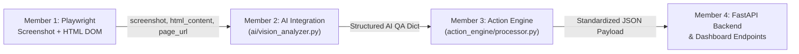

# OmniSight – Member 2: AI/VLM Basic Setup and Prompt Testing (Week 1)

Welcome to the **OmniSight Vision-Language Model (VLM) Analysis Module**. This module is responsible for analyzing website screenshots using Vision-Language Models to detect UI elements (buttons, input fields, text blocks, navigation, media) and identify visual defects (overlapping elements, unreadable text, missing visible elements, and layout/responsiveness bugs).

---

## 📑 Table of Contents
1. [Module Overview & Architecture](#module-overview--architecture)
2. [Folder Structure](#folder-structure)
3. [Windows Setup & Installation](#windows-setup--installation)
4. [Environment Configuration](#environment-configuration)
5. [Running Unit Tests (Mocked - Zero API Cost)](#running-unit-tests-mocked---zero-api-cost)
6. [Executing Visual QA Analysis](#executing-visual-qa-analysis)
   - [Mock Mode (Offline / Testing)](#1-mock-mode-offline--testing)
   - [Live VLM Inference (Gemini 2.5/2.0 Flash)](#2-live-vlm-inference)
7. [Team Integration Guide](#team-integration-guide)
   - [Member 1 (Playwright Automation Hand-off)](#member-1-playwright-automation-hand-off)
   - [Member 3 (FastAPI Backend Integration)](#member-3-fastapi-backend-integration)
8. [JSON Output Schema](#json-output-schema)
9. [Error Handling & Custom Exceptions](#error-handling--custom-exceptions)

---

## 🎯 Module Overview & Architecture

OmniSight operates across specialized member modules:



### Key Capabilities of This Module:
- **Vision-Language Model (VLM) Integration**: Powered by Google's flagship Gemini models (`gemini-2.5-flash`, `gemini-2.0-flash`) via the modern `google-genai` SDK.
- **Reusable Prompt Engineering**: System prompts and task-specific builders that instruct the VLM to act as an automated QA visual engineer.
- **UI Element Inventory**: Automatically catalogues buttons, input fields, text snippets, navigation links, and media assets with locations and states.
- **Visual Defect Detection**: Discovers:
  - **Overlapping Elements**: Buttons covered by text, colliding cards, dialog clipping.
  - **Unreadable Text**: Low-contrast font colors (WCAG AA non-compliant), microscopic font sizes, clipped/truncated copy.
  - **Missing Elements**: Broken image placeholders, unrendered icons, empty containers.
  - **Layout & Responsiveness Bugs**: Misaligned columns, horizontal viewport overflow, awkward whitespace.
- **Robust Error Handling**: Gracefully handles invalid paths, corrupted images, missing API keys, model rate limits, and network issues.
- **Zero-Cost Mock Testing**: Fully isolated unit tests and an offline mock mode allowing immediate development without an API key.

---

## 📂 Folder Structure

```text
Omnisight-1/
├── ai_vision.py          # Core VLM engine (VisionAnalyzer, image validation, Gemini integration)
├── prompts.py            # Reusable QA prompts, system instructions, and JSON schemas
├── config.py             # Environment configuration, dataclass, and custom exception classes
├── result_logger.py      # JSON serialization, report saving, loading, and terminal summary
├── main.py               # Beginner-friendly CLI demo runner and sample screenshot generator
├── requirements.txt      # Python dependencies
├── .env.example          # Environment variable template
├── .gitignore            # Git exclusion rules
├── README.md             # Complete setup and execution documentation
├── analysis_reports/     # Output directory where JSON inspection reports are saved
├── sample_screenshots/   # Sample UI screenshot generated for testing
└── tests/                # Automated unit test suite (100% mocked, zero API calls)
    ├── __init__.py
    ├── test_config.py
    ├── test_prompts.py
    ├── test_result_logger.py
    └── test_ai_vision.py
```

---

## 💻 Windows Setup & Installation

Follow these step-by-step instructions in **Windows PowerShell** or **Command Prompt (cmd)**:

### Step 1: Open PowerShell in Project Directory
Navigate to the project folder:
```powershell
cd C:\Users\USER\OneDrive\Desktop\Omnisight-1
```

### Step 2: Create a Virtual Environment
```powershell
python -m venv venv
```

### Step 3: Activate the Virtual Environment
- **On PowerShell**:
  ```powershell
  .\venv\Scripts\Activate.ps1
  ```
  *(If PowerShell displays an `Execution_Policies` restriction error, run: `Set-ExecutionPolicy -Scope Process -ExecutionPolicy Bypass` then re-run the activation script)*

- **On Command Prompt (cmd)**:
  ```cmd
  venv\Scripts\activate.bat
  ```

### Step 4: Install Dependencies
```powershell
pip install -r requirements.txt
```

---

## ⚙️ Environment Configuration

1. Copy the `.env.example` template to `.env`:
   ```powershell
   copy .env.example .env
   ```

2. Open `.env` in any text editor (Notepad, VS Code) and configure your settings:
   ```ini
   # Get a free Gemini API key at: https://aistudio.google.com/
   GEMINI_API_KEY=AIzaSyYourActualKeyHere

   # Model Selection (defaults to gemini-2.5-flash for speed and multimodal precision)
   VLM_MODEL_NAME=gemini-2.5-flash

   # Set to true for offline synthetic testing without an API key
   VLM_MOCK_MODE=false

   # Directory where output reports are stored
   VLM_OUTPUT_DIR=analysis_reports
   ```

> [!NOTE]
> If you don't have an API key right now, you can leave `GEMINI_API_KEY` blank and use `--mock` mode or set `VLM_MOCK_MODE=true`.

---

## 🧪 Running Unit Tests (Mocked - Zero API Cost)

All unit tests in `tests/` use standard library mocks (`unittest.mock`). **They do not make external API calls, require no API key, and incur zero cost.**

Run the test suite with either runner:

### Option A: Using Python's built-in `unittest`
```powershell
python -m unittest discover tests
```

### Option B: Using `pytest`
```powershell
pytest -v
```

Expected output:
```text
Ran 32 tests in ~1.5s
OK
```

### What is tested:
- `test_config.py`: Default settings, `.env` loading, and custom exception inheritance.
- `test_prompts.py`: Prompt builder, focus areas injection, JSON schema validation, mock data structure.
- `test_result_logger.py`: JSON file serialization, directory auto-creation, loading saved reports, summary formatting.
- `test_ai_vision.py`:
  - Image validation: missing files, wrong extensions, file size limits, corrupted images.
  - JSON parser: raw JSON, markdown-fenced (```json ... ```) stripping, error handling for bad JSON.
  - Mock mode end-to-end execution.
  - Mocked `google.genai.Client`: simulates successful VLM responses, network timeouts, empty responses, and API errors.

---

## 🚀 Executing Visual QA Analysis

### 1. Mock Mode (Offline / Testing)
Run a complete visual QA analysis without an API key using the included synthetic generator:
```powershell
python main.py --mock
```

This will:
1. Automatically create a test screenshot at `sample_screenshots/sample_ui.png` (featuring intentional defects: an overlapping button badge and low contrast footer text).
2. Execute the QA vision pipeline.
3. Print a formatted terminal summary report.
4. Save the full JSON report to `analysis_reports/sample_ui_analysis_<timestamp>.json`.

### 2. Live VLM Inference
To analyze an actual browser screenshot captured by Member 1 using Google Gemini VLM:
```powershell
python main.py path\to\browser_screenshot.png
```

Optional CLI flags:
```powershell
# Specify a custom model
python main.py path\to\screenshot.png --model gemini-2.0-flash

# Specify a custom output folder
python main.py path\to\screenshot.png --output-dir custom_reports

# Pass API key directly on the command line
python main.py path\to\screenshot.png --key AIzaSy...
```

---

## 🤝 Team Integration Guide

### Member 1 (Playwright Automation Hand-off)
When Member 1's Playwright script saves a screenshot, they can invoke Member 2's module directly in Python:

```python
from ai_vision import analyze_and_save

# Screenshot produced by Playwright
screenshot_file = "screenshots/checkout_page.png"

# Run visual analysis and save JSON report in one call
report_dict, json_path = analyze_and_save(
    image_path=screenshot_file,
    output_dir="analysis_reports"
)

print(f"Visual Health Score: {report_dict['visual_health_score']}/100")
print(f"Detected {len(report_dict['visual_issues'])} visual issues.")
print(f"Report saved to: {json_path}")
```

### Member 3 (FastAPI Backend Integration)
Member 3 can easily integrate `VisionAnalyzer` into a FastAPI route:

```python
from fastapi import FastAPI, HTTPException, UploadFile, File
from pathlib import Path
import shutil

from ai_vision import VisionAnalyzer
from config import OmniSightVisionError

app = FastAPI(title="OmniSight Visual QA API")
analyzer = VisionAnalyzer()  # Reads GEMINI_API_KEY from .env

@app.post("/api/v1/analyze-screenshot")
async def analyze_screenshot_endpoint(file: UploadFile = File(...)):
    # Save uploaded screenshot to temporary storage
    temp_path = Path("temp_uploads") / file.filename
    temp_path.parent.mkdir(parents=True, exist_ok=True)
    
    with open(temp_path, "wb") as buffer:
        shutil.copyfileobj(file.file, buffer)
        
    try:
        results = analyzer.analyze_screenshot(temp_path)
        return results
    except OmniSightVisionError as err:
        raise HTTPException(status_code=400, detail=str(err))
    finally:
        if temp_path.exists():
            temp_path.unlink()
```

---

## 📋 JSON Output Schema

Analysis results are returned as a standard Python dictionary and saved as structured JSON:

```json
{
  "page_summary": "E-commerce landing page featuring a promotional hero section, navigation bar, and product grid.",
  "visual_health_score": 78,
  "ui_elements": {
    "buttons": [
      {
        "label": "Shop Now",
        "type": "primary",
        "location": "hero section center",
        "state": "normal"
      }
    ],
    "input_fields": [
      {
        "placeholder": "Search products...",
        "type": "search",
        "location": "header center",
        "has_visible_label": false
      }
    ],
    "text_elements": [
      {
        "text_snippet": "Summer Collection 2026",
        "role": "h1",
        "readability": "high"
      }
    ],
    "navigation_elements": [
      {
        "label": "Home",
        "type": "nav_link",
        "location": "header"
      }
    ],
    "media_elements": [
      {
        "type": "logo",
        "location": "top-left header",
        "status": "rendered_properly"
      }
    ]
  },
  "visual_issues": [
    {
      "issue_id": "ISSUE-001",
      "category": "overlapping_elements",
      "severity": "high",
      "title": "Hero subtitle overlaps primary CTA button",
      "location": "Hero section, center right",
      "description": "The description paragraph extends downwards and overlaps the top 20% of the 'Shop Now' button on smaller viewports.",
      "recommendation": "Add `margin-bottom: 1.5rem` to the subtitle paragraph or wrap in a flex column layout."
    },
    {
      "issue_id": "ISSUE-002",
      "category": "unreadable_text",
      "severity": "medium",
      "title": "Low contrast on footer newsletter disclaimer",
      "location": "Footer section, bottom center",
      "description": "Light grey text on white background fails WCAG 2.1 AA minimum contrast requirement.",
      "recommendation": "Darken font color to at least #595959."
    }
  ],
  "recommendations": [
    "Fix hero section flexbox gap to prevent button overlap.",
    "Increase text contrast in footer disclaimer to meet WCAG AA standards."
  ],
  "metadata": {
    "timestamp": "2026-10-16T07:00:00.000000+00:00",
    "screenshot_path": "C:\\screenshots\\sample_ui.png",
    "screenshot_filename": "sample_ui.png",
    "image_dimensions": {
      "width": 1200,
      "height": 800
    },
    "file_size_bytes": 20895,
    "model": "gemini-2.5-flash",
    "status": "success",
    "mock_mode": false,
    "duration_seconds": 1.45
  }
}
```

---

## 🛡️ Error Handling & Custom Exceptions

All module exceptions inherit from `OmniSightVisionError` (`config.py`), making it straightforward for upstream consumers (such as Member 3's FastAPI app) to catch and translate errors:

| Exception | Cause | Remedy |
| :--- | :--- | :--- |
| `APIKeyMissingError` | `GEMINI_API_KEY` not found and `mock_mode=False` | Add API key to `.env` or run with `--mock` |
| `ImageNotFoundError` | File path does not exist on disk | Check Playwright screenshot file path |
| `InvalidImageFormatError` | Extension is not `.png`, `.jpg`, `.webp`, etc. | Convert image or verify file extension |
| `ImageCorruptedError` | File bytes cannot be decoded by PIL | Ensure Playwright finished writing before analyzing |
| `ImageSizeExceededError` | Image exceeds `MAX_IMAGE_SIZE_MB` (15 MB) | Resize or compress screenshot before analysis |
| `ModelInferenceError` | VLM API rate limit, quota error, or timeout | Verify internet connection and API key quota |
| `ResponseParseError` | VLM response could not be parsed as valid JSON | Check prompt formatting or retry request |

---

# 🚀 OmniSight Week 2: Member 2 (AI Integration) & Member 3 (Action Engine)

In Week 2, OmniSight extends its capabilities with dedicated packages for:
1. **Member 2 (`ai/`)**: Advanced Vision-Language Model visual defect detection powered by Google Gemini, detecting overlapping text, misaligned buttons, clipped elements, and responsive layout issues, with structured CSS fixes.
2. **Member 3 (`action_engine/`)**: Resilient Action Engine that validates AI responses, handles malformed/missing data safely, and compiles standardized JSON-compatible remediation actions for Member 4's FastAPI integration.



---

## 🧠 Member 2 – AI Integration (`ai/`)

### Module Files
- `ai/vision_analyzer.py`: Main `VisionAnalyzer` class and `analyze_screenshot()` function.
- `ai/prompts.py`: System prompt, task builder `build_analysis_prompt()`, JSON schema, and mock generator `get_mock_vlm_response()`.
- `ai/test_vision.py`: Comprehensive test suite with mocked Gemini client (17 tests, zero API cost).

### Key Function: `analyze_screenshot`
```python
from ai.vision_analyzer import analyze_screenshot

result = analyze_screenshot(
    screenshot="sample_screenshots/sample_ui.png",  # str path, Path, bytes, or PIL Image
    html_content="<div class='metrics-grid'><button class='btn-primary'>Run</button></div>",  # optional DOM context
    page_url="https://app.omnisight.local/dashboard",  # optional target URL
    mock_mode=True  # set to False for live Gemini inference
)
```

### Detected Defect Categories
1. **`overlapping_text`**: Text colliding with or obscuring headings, CTA buttons, badges, or card boundaries.
2. **`misaligned_buttons`**: Buttons out of alignment with sibling buttons, flexbox baselines, or grid containers.
3. **`clipped_elements`**: Text truncated without ellipsis, containers clipping content due to overflow hidden.
4. **`responsive_layout`**: Viewport horizontal scrolling, awkward line wrapping, or unhandled mobile/tablet boundaries.

### Structured CSS Fixes
Every issue contains a structured `suggested_fix` dictionary, and the top-level response aggregates them in `css_fixes`:
```json
{
  "css_fixes": {
    ".hero-subtitle": {
      "selector": ".hero-subtitle",
      "properties": {
        "margin-bottom": "24px",
        "line-height": "1.4"
      },
      "css_rule": ".hero-subtitle { margin-bottom: 24px; line-height: 1.4; }",
      "issue_id": "ISSUE-001",
      "description": "Add bottom margin to push the button below the text block and normalize line height."
    }
  }
}
```

### Secret Protection
API keys are loaded via `os.getenv("GEMINI_API_KEY")` (with `load_dotenv()` from `.env`). Secrets are never hardcoded. When offline or testing, `mock_mode=True` allows zero-cost verification.

---

## ⚙️ Member 3 – Action Engine (`action_engine/`)

### Module Files
- `action_engine/processor.py`: Implementation of `process_ai_response()`.
- `action_engine/validators.py`: Pydantic models (`VisualIssueModel`, `CSSFixModel`, `StandardizedReportModel`) and normalization utilities.
- `action_engine/test_processor.py`: Comprehensive unit tests (14 tests).
- `validators.py` and `test_processor.py`: Root bridges for direct root imports and test runners.

### Key Function: `process_ai_response`
```python
from action_engine.processor import process_ai_response

# Accepts parsed dict or raw JSON string
processed = process_ai_response(result)
```

### Resilience & Safety Features
- **Invalid JSON**: Catches malformed JSON and syntax errors safely, returning `{ "status": "error", "valid": False, "errors": [...] }` without raising uncaught exceptions.
- **Markdown Fences**: Automatically strips markdown blocks (````json ... ````).
- **Missing Fields**: Gracefully backfills defaults for `page_summary`, `recommendations`, `ui_elements`, and computes `visual_health_score` dynamically based on issue severities.
- **Empty Issues**: Correctly reports a pristine healthy page (`total_issues: 0`, `visual_health_score: 100`, `status: "success"`).
- **Prioritized Actions**: Sorts actionable fixes by severity (`critical` = priority 1, `high` = 2, `medium` = 3, `low` = 4).
- **100% JSON-Compatible**: All outputs can be passed directly to `json.dumps()` or FastAPI's `JSONResponse`.

---

## 🔗 Member 4 Integration Guide (FastAPI Example)

Member 4 can integrate Member 2 and Member 3 seamlessly inside a FastAPI endpoint:

```python
from fastapi import FastAPI, UploadFile, File, Form, HTTPException
from fastapi.responses import JSONResponse
from ai.vision_analyzer import analyze_screenshot
from action_engine.processor import process_ai_response

app = FastAPI(title="OmniSight Automated Visual QA API")

@app.post("/api/v1/analyze-ui")
async def analyze_ui_endpoint(
    screenshot: UploadFile = File(...),
    html_content: str = Form(None),
    page_url: str = Form(None),
    mock_mode: bool = Form(False),
):
    try:
        # Read uploaded image bytes directly
        image_bytes = await screenshot.read()
        
        # Step 1: Member 2 analyzes screenshot using VLM
        ai_response = analyze_screenshot(
            screenshot=image_bytes,
            html_content=html_content,
            page_url=page_url,
            mock_mode=mock_mode,
        )
        
        # Step 2: Member 3 validates, extracts CSS fixes, and standardizes payload
        standardized_report = process_ai_response(ai_response)
        
        # Step 3: Return clean JSON to client or frontend dashboard
        return JSONResponse(content=standardized_report)
        
    except Exception as e:
        raise HTTPException(status_code=500, detail=str(e))
```

---

## 📄 Example Outputs

Sample JSON reports generated by the pipeline are saved in:
- `analysis_reports/example_member2_ai_output.json`: Full VLM output containing issues, structured CSS fixes, and UI element inventory.
- `analysis_reports/example_member3_action_engine_output.json`: Action Engine standardized payload with severity counts, category distribution, and prioritized remediation actions.

### Example Action Engine Output Snippet
```json
{
  "status": "success",
  "valid": true,
  "page_url": "https://omnisight.local/dashboard",
  "page_summary": "Web application dashboard showing navigation bar and action controls.",
  "visual_health_score": 72,
  "total_issues": 4,
  "issues_by_severity": {
    "critical": 0,
    "high": 2,
    "medium": 2,
    "low": 0
  },
  "issues_by_category": {
    "overlapping_text": 1,
    "misaligned_buttons": 1,
    "clipped_elements": 1,
    "responsive_layout": 1
  },
  "css_fixes": {
    ".hero-subtitle": {
      "selector": ".hero-subtitle",
      "properties": {
        "margin-bottom": "24px",
        "line-height": "1.4"
      },
      "css_rule": ".hero-subtitle { margin-bottom: 24px; line-height: 1.4; }",
      "issue_id": "ISSUE-001",
      "description": "Add bottom margin to push the button below the text block"
    }
  },
  "actions": [
    {
      "priority": 2,
      "issue_id": "ISSUE-001",
      "severity": "high",
      "category": "overlapping_text",
      "selector": ".hero-subtitle",
      "action_type": "apply_css_fix",
      "css_rule": ".hero-subtitle { margin-bottom: 24px; line-height: 1.4; }",
      "explanation": "Add bottom margin to push the button below the text block"
    }
  ]
}
```

---

## 🧪 Running Automated Tests

Run the complete test suite (100% mocked, zero API costs):
```bash
python -m pytest
```

Run Member 2 unit tests:
```bash
python -m pytest ai/test_vision.py
```

Run Member 3 unit tests:
```bash
python -m pytest action_engine/test_processor.py
```

