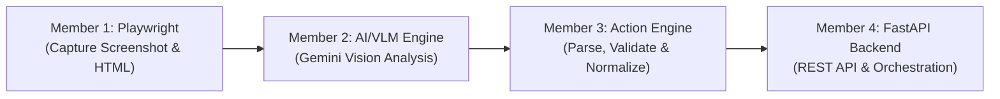

# OmniSight – Member 3: Action Engine (Python + JSON)

The **Action Engine** is Member 3's core module within the OmniSight Multimodal UI Self-Healing & RPA Agent.

---

## 📑 Table of Contents
1. [Purpose of the Action Engine](#-purpose-of-the-action-engine)
2. [Folder and File Structure](#-folder-and-file-structure)
3. [Python Setup & Installation](#-python-setup--installation)
4. [How to Run the Tests](#-how-to-run-the-tests)
5. [Example AI/VLM Input](#-example-aivlm-input)
6. [Example Normalized JSON Output](#-example-normalized-json-output)
7. [Integration Guide for Member 4 (FastAPI Backend)](#-integration-guide-for-member-4-fastapi-backend)
8. [Importing and Calling the Action Engine](#-importing-and-calling-the-action-engine)
9. [Security: Zero Code Execution Guarantee](#-security-zero-code-execution-guarantee)

---

## 🎯 Purpose of the Action Engine

OmniSight detects UI/UX visual defects on web pages and generates automated remediation suggestions. The end-to-end pipeline operates across four team members:



### Member 3 Responsibilities:
- **Safely Ingest Member 2's Output**: Accepts AI/VLM responses as Python dictionaries, JSON strings, or markdown-wrapped code blocks (` ```json ... ``` `).
- **Normalize Defect Schema**: Standardizes issue elements, types, severities, descriptions, and suggested CSS fixes into a consistent schema.
- **Strict Validation**: Validates required fields, data types, and severity levels (`critical`, `high`, `medium`, `low`).
- **Resilient Recovery**: Injects sensible fallback values if non-critical fields are absent, ensuring downstream services never crash.
- **Ensure JSON Compliance**: Guarantees 100% valid JSON serialization for Member 4's FastAPI endpoints.
- **Zero Execution Security**: Treats AI-generated CSS and Python as inert data—**never executes or evals AI code automatically**.

---

## 📂 Folder and File Structure

```text
Omnisight-1/
├── action_engine/
│   ├── __init__.py              # Package entry point exposing core parser and models
│   ├── action_parser.py         # Main Action Engine implementation (parse, validate, normalize, convert)
│   ├── test_action_parser.py    # 15 automated unit tests covering all 10 required test cases
│   ├── README.md                # Action Engine technical and integration documentation
│   ├── processor.py             # Advanced analysis processor (health score, prioritized actions)
│   ├── test_processor.py        # Processor test suite
│   └── validators.py            # Pydantic schemas and taxonomy helpers
└── tests/
    └── test_action_parser.py    # Root discovery bridge for automated CI/CD test runners
```

### Key Files:
- **`action_engine/action_parser.py`**:
  - `parse_ai_response(ai_response)`: Parses and validates the AI/VLM response.
  - `normalize_issue(issue)`: Converts a single issue dictionary into the standard format.
  - `validate_issue(issue)`: Validates required fields and data types, returning a `ValidationResult`.
  - `convert_to_json(result)`: Serializes results into pretty-printed, validated JSON.
- **`action_engine/test_action_parser.py`**:
  - Contains isolated unit tests running in < 0.05s without network or API keys.

---

## 💻 Python Setup & Installation

The Action Engine requires **Python 3.10+** (tested and validated on Python 3.14).

### Step 1: Open Terminal in Project Directory
```powershell
cd C:\Users\USER\OneDrive\Desktop\Omnisight-1
```

### Step 2: (Optional) Activate Virtual Environment
If you are using a virtual environment:
```powershell
# Windows PowerShell:
.\venv\Scripts\Activate.ps1

# Windows Command Prompt (cmd):
venv\Scripts\activate.bat
```

### Step 3: Install Required Dependencies
```powershell
pip install -r requirements.txt
```
*Note: The Action Engine itself uses Python's standard library (`json`, `re`, `logging`, `typing`, `unittest`) and `pydantic` for optional schema validation.*

---

## 🧪 How to Run the Tests

All tests are completely offline and require **zero API keys, no internet connection, and no live AI models**.

### Run Action Engine Unit Tests Directly:
```powershell
python action_engine/test_action_parser.py
```

### Run via Python unittest Module:
```powershell
python -m unittest action_engine/test_action_parser.py
```

### Run via Root Bridge:
```powershell
python -m unittest tests/test_action_parser.py
```

### Run with Pytest:
```powershell
pytest action_engine/test_action_parser.py -v
```

### Run Entire OmniSight Test Suite:
```powershell
python -m unittest discover
```

### Test Coverage (10 Required Cases):
| # | Test Case Description | Test Method | Result |
|---|----------------------|-------------|:------:|
| 1 | Valid AI/VLM response containing one UI issue | `test_case_1_valid_response_single_issue` | PASSED |
| 2 | Response containing multiple UI issues | `test_case_2_response_multiple_issues` | PASSED |
| 3 | AI response provided as a JSON string (plain & markdown-fenced) | `test_case_3_response_as_json_string`, `test_case_3b_response_as_markdown_fenced_json` | PASSED |
| 4 | Empty AI response (`None`, `""`, whitespace, `{}`) | `test_case_4_empty_response` | PASSED |
| 5 | Malformed JSON strings handled safely | `test_case_5_malformed_json` | PASSED |
| 6 | Missing required fields flagged & recovered | `test_case_6_missing_required_fields` | PASSED |
| 7 | Invalid severity values normalized & flagged | `test_case_7_invalid_severity_values` | PASSED |
| 8 | Unexpected data types handled gracefully | `test_case_8_unexpected_data_types` | PASSED |
| 9 | No UI issues detected (pristine/clean page) | `test_case_9_no_ui_issues_detected` | PASSED |
| 10 | Correct JSON output serialization & issue count match | `test_case_10_correct_json_output_and_issue_count` | PASSED |

---

## 📥 Example AI/VLM Input

Member 2 may return results either as a Python dictionary or as a raw JSON string:

### Input Example 1 (Standard Dictionary from Member 2):
```json
{
  "status": "success",
  "issues": [
    {
      "element": "Submit button",
      "issue_type": "misalignment",
      "severity": "medium",
      "description": "The submit button is not aligned with the input fields.",
      "suggested_fix": {
        "css": "display: flex; align-items: center;"
      }
    }
  ]
}
```

### Input Example 2 (VLM Visual Analysis Format):
```json
{
  "page_summary": "User settings dashboard.",
  "visual_issues": [
    {
      "issue_id": "ISSUE-001",
      "category": "misaligned_button",
      "severity": "medium",
      "selector": "#submit-btn",
      "title": "Submit button alignment offset",
      "description": "The submit button is not aligned with the input fields.",
      "recommendation": "Add `display: flex; align-items: center;` to the form action container."
    }
  ]
}
```

### Input Example 3 (Raw String Wrapped in Markdown):
````text
```json
{
  "issues": [
    {
      "element": ".btn-primary",
      "issue_type": "overlapping_text",
      "severity": "high",
      "description": "Text overlaps badge container.",
      "suggested_fix": "margin-bottom: 16px;"
    }
  ]
}
```
````

---

## 📤 Example Normalized JSON Output

Regardless of input variations or formatting quirks, the Action Engine always outputs standardized JSON matching this exact structure:

```json
{
  "status": "success",
  "total_issues": 1,
  "issues": [
    {
      "element": "Submit button",
      "issue_type": "misalignment",
      "severity": "medium",
      "description": "The submit button is not aligned with the input fields.",
      "suggested_fix": {
        "css": "display: flex; align-items: center;"
      }
    }
  ],
  "errors": []
}
```

### Clean UI State (No Defects Detected):
```json
{
  "status": "success",
  "total_issues": 0,
  "issues": [],
  "errors": []
}
```

### Validation Error State:
```json
{
  "status": "error",
  "total_issues": 1,
  "issues": [
    {
      "element": "Submit button",
      "issue_type": "general_issue",
      "severity": "medium",
      "description": "No description provided.",
      "suggested_fix": {
        "css": ""
      }
    }
  ],
  "errors": [
    "Issue [Submit button]: Missing required field: 'issue_type'.",
    "Issue [Submit button]: Missing required field: 'description'."
  ]
}
```

---

## 🤝 Integration Guide for Member 4 (FastAPI Backend)

Member 4 can import and plug the Action Engine directly into FastAPI route handlers.

### Fast, Dependency-Free Integration:

```python
from fastapi import FastAPI, HTTPException
from pydantic import BaseModel
from typing import Any, Dict

from action_engine import parse_ai_response, ActionEngineResponseModel

app = FastAPI(title="OmniSight Backend API")

@app.post("/api/v1/process-actions", response_model=ActionEngineResponseModel)
async def process_actions_endpoint(ai_output: Dict[str, Any]):
    """
    Receives Member 2's AI/VLM output and returns validated, structured actions.
    """
    result = parse_ai_response(ai_output)
    return result
```

### Working with Raw Strings from AI Models:
```python
from fastapi import FastAPI, Body
from action_engine import parse_ai_response

app = FastAPI()

@app.post("/api/v1/process-raw-vlm")
async def process_raw_vlm(raw_text: str = Body(..., media_type="text/plain")):
    # Safely parses string, strips markdown fences, validates and returns dict
    result = parse_ai_response(raw_text)
    return result
```

---

## 🚀 Importing and Calling the Action Engine

Here is how other Python modules can use the Action Engine:

```python
from action_engine import (
    parse_ai_response,
    normalize_issue,
    validate_issue,
    convert_to_json,
)

# 1. Parsing raw response from Member 2
raw_vlm_output = {
    "issues": [
        {
            "element": "Navbar brand",
            "issue_type": "overlap",
            "severity": "high",
            "description": "Brand logo overlaps user greeting text.",
            "suggested_fix": {"css": "margin-right: 20px;"}
        }
    ]
}

parsed_result = parse_ai_response(raw_vlm_output)
print(f"Status: {parsed_result['status']}")
print(f"Total Issues: {parsed_result['total_issues']}")

# 2. Converting to valid JSON string
json_string = convert_to_json(parsed_result)
print(json_string)

# 3. Validating an individual issue
is_valid, errors = validate_issue(raw_vlm_output["issues"][0])
if is_valid:
    print("Issue passed all validation checks!")
else:
    print(f"Validation errors: {errors}")

# 4. Normalizing an arbitrary issue dictionary
normalized = normalize_issue({
    "selector": ".btn-cancel",
    "category": "misaligned_buttons",
    "severity": "LOW",
    "recommendation": "vertical-align: middle;"
})
print(normalized)
```

---

## 🔒 Security: Zero Code Execution Guarantee

A critical architectural rule for Member 3's Action Engine is **safety**:
- Suggested CSS fixes and recommendations are extracted and stored **strictly as plain-text data**.
- No `eval()`, `exec()`, `os.system()`, or browser injection is performed.
- Downstream modules (Member 4 or the RPA healing agent) must apply CSS safely through approved sandboxed browser APIs.
